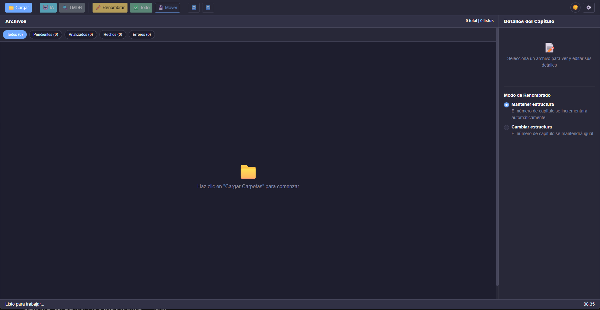

# OrganizadorCapitulos.Maui

[](https://github.com/cgutierrez98/OrganizadorCapitulos-Maui/actions/workflows/ci.yml)
[](LICENSE)


> [Leer en Español](README.md)



**OrganizadorCapitulos.Maui** is a Windows desktop application built with **.NET MAUI + BlazorWebView** designed to parse, rename, and organize TV show episodes and movies quickly, safely, and reversibly.

---

## Key Features

- **Flexible file loading:** Built-in folder browser and **native WinUI drag-and-drop** for video folders or exported `.json` session files.
- **Local pattern parser & optional Python helper:**
  - Automatic C# parsing ([EpisodePatternParser.cs](SharedLogic/Application/Services/EpisodePatternParser.cs)) for `S01E01`, `1x01`, `Season X Episode Y`, `Temporada X Capitulo Y`, anime absolute numbering, movies with release years, and cleanup of quality/fansub tags.
  - Optional Python helper script ([Python/ai_service.py](Python/ai_service.py)) integrated via [PythonAIService.cs](SharedLogic/Infrastructure/Services/PythonAIService.cs) for on-demand analysis.
- **TMDB integration:**
  - Search **TV series and movies** with poster thumbnails, release year, and overview snippets.
  - Configurable metadata language (`es-ES`, `es-MX`, `en-US`, etc.) with automatic fallback to English.
  - Fetch episode titles by season/episode or fuzzy-match by episode title (ignoring accents and punctuation), with parallel season fetching and cancellation support.
  - Batch auto-identification for movies and encrypted API Key/Token storage using **Windows DPAPI**.
- **Safe & customizable renaming:**
  - Three strategies: **Maintain structure** (sequential numbering), **Change structure** (strict mode), and **Movie mode**.
  - **Visual filename template builder** (`{Title}`, `{Season}`, `{Episode}`, `{EpisodeTitle}`, `{Year}`) with live preview.
  - Pre-rename **dry-run** confirmation dialog and visual collision indicators before touching disk.
  - **Companion subtitle handling:** automatically renames and moves associated `.srt`, `.ass`, `.ssa`, `.vtt`, `.sub`, `.idx`, and `.nfo` files (including language suffixes such as `.en.srt` or `.es.srt`).
- **Plex / Jellyfin folder organization:** Optional structured move that creates `Series/Temporada 01/` or `Movie (Year)/` subfolders automatically.
- **Productivity & control:**
  - Instant search, status filters, multi-selection checkboxes, and batch editing (*Apply to all*, *Season to all*, *Sequential renumbering*).
  - **Atomic batch Undo / Redo** persisted across sessions ([UndoRedoService.cs](Services/UndoRedoService.cs)) and full operation history ([OperationLogService.cs](Services/OperationLogService.cs)).
  - Session export/import (`.json`), light/dark theme toggle, and keyboard shortcuts (`?` for the cheat sheet, `Esc` to close dialogs).

---

## Tech Stack & Architecture

- **Target platform:** Windows 10/11 (`net9.0-windows10.0.19041.0`)
- **UI:** .NET MAUI with `BlazorWebView` (Razor components)
- **Libraries:** `CommunityToolkit.Maui`, `CommunityToolkit.Mvvm`
- **Testing:** xUnit (`tests/OrganizadorCapitulos.Tests`)
- **Helper script (optional):** Python 3 (`Python/ai_service.py`)

### Project Structure

- `OrganizadorCapitulos.Maui.csproj` — Windows MAUI Blazor desktop application.
- `SharedLogic/` — Reusable domain logic (entities, rename strategies, `EpisodePatternParser`, `FileOrganizerService`, `TmdbMetadataService`, `PythonAIService`).
- `ViewModels/HomeViewModel.cs` — UI state coordination and MVVM commands.
- `Components/` — Razor components (`Pages/Home.razor`, `FileList.razor`, `DetailsForm.razor`, `TmdbSearchDialog.razor`, `SettingsDialog.razor`, etc.).
- `Services/` — Application services (`SettingsService`, `UndoRedoService`, `OperationLogService`, `ThemeService`, `DragDropService`).
- `tests/OrganizadorCapitulos.Tests/` — Unit test suite.

---

## Requirements

- **.NET 9 SDK** with the MAUI Windows workload:
  ```powershell
  dotnet workload install maui-windows
  ```
- **Python 3** (optional, only needed if you use the *Analyze* action with `Python/ai_service.py`).

---

## Build, Run & Test

```powershell
# Build the solution
dotnet build OrganizadorCapitulos-Maui.sln

# Run the application
dotnet run --project OrganizadorCapitulos.Maui.csproj

# Run unit tests
dotnet test tests/OrganizadorCapitulos.Tests/OrganizadorCapitulos.Tests.csproj
```

### Using the Python script (optional)

```powershell
python Python/ai_service.py analyze --input "Breaking.Bad.S01E01.1080p.mkv"
```

---

## Publishing (Windows)

Build a self-contained unpackaged Windows x64 release:

```powershell
dotnet publish OrganizadorCapitulos.Maui.csproj -c Release -f net9.0-windows10.0.19041.0 -r win-x64 --self-contained true -p:WindowsPackageType=None -p:WindowsAppSDKSelfContained=true -o ./publish/windows
```

Tagged releases (`v*`) are built and published automatically via [GitHub Actions](.github/workflows/release.yml).

---

## Extensibility

- **`IAIService` / `PythonAIService`** ([SharedLogic/Infrastructure/Services/PythonAIService.cs](SharedLogic/Infrastructure/Services/PythonAIService.cs)): implement `IAIService` to plug in another parser or LLM provider.
- **`IMetadataService` / `TmdbMetadataService`** ([SharedLogic/Infrastructure/Services/TmdbMetadataService.cs](SharedLogic/Infrastructure/Services/TmdbMetadataService.cs)): extensible metadata provider interface for additional sources beyond TMDB.
- **`IRenameStrategy` / `RenameStrategyFactory`** ([SharedLogic/Application/Strategies](SharedLogic/Application/Strategies)): add or customize renaming rules.
- **`FileOrganizerService`** ([SharedLogic/Application/Services/FileOrganizerService.cs](SharedLogic/Application/Services/FileOrganizerService.cs)): core file loading, companion-aware renaming, and structured folder moving.

---

## License

Distributed under the **MIT License**. See [LICENSE](LICENSE) for details.
