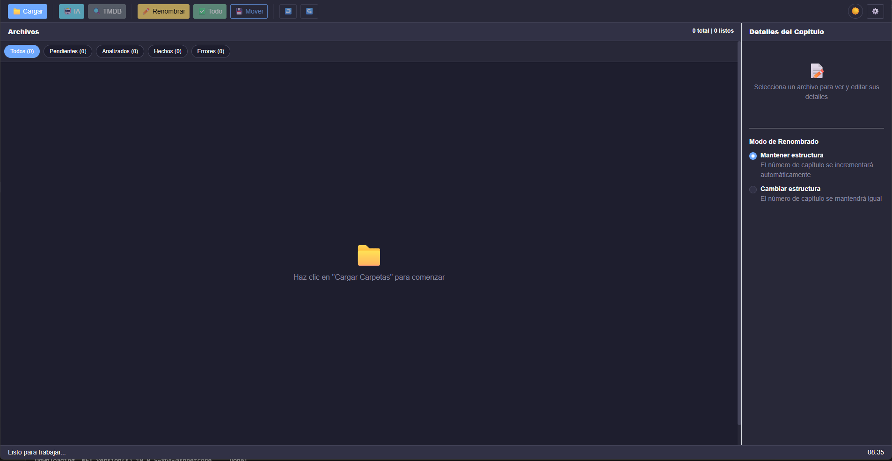

# OrganizadorCapitulos.Maui

[](https://github.com/cgutierrez98/OrganizadorCapitulos-Maui/actions/workflows/ci.yml)
[](LICENSE)




**OrganizadorCapitulos.Maui** es una aplicación de escritorio para Windows construida con **.NET MAUI + BlazorWebView** diseñada para analizar, renombrar y organizar capítulos de series y películas de forma rápida, segura y reversible.

---

## Características principales

- **Carga flexible de archivos:** Explorador de carpetas integrado y **arrastrar y soltar nativo (WinUI)** para carpetas de video o archivos `.json` de sesiones exportadas.
- **Análisis automático local y script Python auxiliar:**
  - Detección automática en C# ([EpisodePatternParser.cs](SharedLogic/Application/Services/EpisodePatternParser.cs)) de patrones `S01E01`, `1x01`, `Season X Episode Y`, `Temporada X Capitulo Y`, numeración absoluta de anime, películas con año y limpieza de etiquetas de calidad/fansub.
  - Script auxiliar en Python ([Python/ai_service.py](Python/ai_service.py)) integrado mediante [PythonAIService.cs](SharedLogic/Infrastructure/Services/PythonAIService.cs) para análisis adicional bajo demanda.
- **Integración con TMDB:**
  - Búsqueda de **series y películas** con póster, año y sinopsis.
  - Idioma configurable (`es-ES`, `es-MX`, `en-US`, etc.) con fallback automático a inglés.
  - Descarga de títulos por episodio o emparejamiento aproximado por nombre (ignorando tildes y puntuación), con descarga paralela y cancelación.
  - Auto-identificación en lote para películas y almacenamiento cifrado de la API Key/Token con **DPAPI** en Windows.
- **Renombrado seguro y personalizable:**
  - Tres estrategias: **Mantener estructura** (numeración secuencial), **Cambiar estructura** (modo estricto) y **Modo Película**.
  - **Constructor visual de plantillas** (`{Title}`, `{Season}`, `{Episode}`, `{EpisodeTitle}`, `{Year}`) con vista previa en vivo.
  - Confirmación previa (*dry-run*) y aviso visual de colisiones antes de tocar archivos en disco.
  - **Subtítulos acompañantes:** renombra y mueve automáticamente archivos `.srt`, `.ass`, `.ssa`, `.vtt`, `.sub`, `.idx` y `.nfo` (incluyendo sufijos de idioma como `.es.srt`).
- **Organización en carpetas estilo Plex / Jellyfin:** Opción para mover archivos creando automáticamente la estructura `Serie/Temporada 01/` o `Película (Año)/`.
- **Productividad y control:**
  - Buscador instantáneo, filtros por estado, selección múltiple y edición en lote (*Aplicar a todos*, *Temporada a todos*, *Renumeración secuencial*).
  - **Deshacer / Rehacer atómico por lote** persistente entre sesiones ([UndoRedoService.cs](Services/UndoRedoService.cs)) e historial completo de operaciones ([OperationLogService.cs](Services/OperationLogService.cs)).
  - Exportación e importación de sesiones en `.json`, tema claro/oscuro y atajos de teclado (`?` para ver la guía, `Esc` para cerrar diálogos).

---

## Tecnologías y arquitectura

- **Plataforma objetivo:** Windows 10/11 (`net9.0-windows10.0.19041.0`)
- **UI:** .NET MAUI con `BlazorWebView` (componentes Razor)
- **Librerías:** `CommunityToolkit.Maui`, `CommunityToolkit.Mvvm`
- **Tests:** xUnit (`tests/OrganizadorCapitulos.Tests`)
- **Script auxiliar (opcional):** Python 3 (`Python/ai_service.py`)

### Estructura del proyecto

- `OrganizadorCapitulos.Maui.csproj` — Aplicación de escritorio MAUI Blazor para Windows.
- `SharedLogic/` — Lógica de dominio reutilizable (entidades, estrategias de renombrado, `EpisodePatternParser`, `FileOrganizerService`, `TmdbMetadataService`, `PythonAIService`).
- `ViewModels/HomeViewModel.cs` — Coordinación del estado de la interfaz y comandos MVVM.
- `Components/` — Componentes Razor (`Pages/Home.razor`, `FileList.razor`, `DetailsForm.razor`, `TmdbSearchDialog.razor`, `SettingsDialog.razor`, etc.).
- `Services/` — Servicios de aplicación (`SettingsService`, `UndoRedoService`, `OperationLogService`, `ThemeService`, `DragDropService`).
- `tests/OrganizadorCapitulos.Tests/` — Suite de pruebas unitarias.

---

## Requisitos

- **.NET 9 SDK** con el workload de MAUI para Windows:
  ```powershell
  dotnet workload install maui-windows
  ```
- **Python 3** (opcional, solo si deseas usar el botón *Analizar* con `Python/ai_service.py`).

---

## Instalación, ejecución y tests

```powershell
# Compilar la solución
dotnet build OrganizadorCapitulos-Maui.sln

# Ejecutar la aplicación
dotnet run --project OrganizadorCapitulos.Maui.csproj

# Ejecutar los tests unitarios
dotnet test tests/OrganizadorCapitulos.Tests/OrganizadorCapitulos.Tests.csproj
```

### Uso del script Python (opcional)

```powershell
python Python/ai_service.py analyze --input "Breaking.Bad.S01E01.1080p.mkv"
```

---

## Publicación (Windows)

Para generar un paquete autocontenido sin MSIX para Windows x64:

```powershell
dotnet publish OrganizadorCapitulos.Maui.csproj -c Release -f net9.0-windows10.0.19041.0 -r win-x64 --self-contained true -p:WindowsPackageType=None -p:WindowsAppSDKSelfContained=true -o ./publish/windows
```

Las publicaciones oficiales etiquetadas (`v*`) se generan automáticamente mediante [GitHub Actions](.github/workflows/release.yml).

---

## Extensibilidad

- **`IAIService` / `PythonAIService`** ([SharedLogic/Infrastructure/Services/PythonAIService.cs](SharedLogic/Infrastructure/Services/PythonAIService.cs)): implementa `IAIService` para conectar otro analizador o proveedor LLM.
- **`IMetadataService` / `TmdbMetadataService`** ([SharedLogic/Infrastructure/Services/TmdbMetadataService.cs](SharedLogic/Infrastructure/Services/TmdbMetadataService.cs)): proveedor de metadatos extensible para añadir otras fuentes además de TMDB.
- **`IRenameStrategy` / `RenameStrategyFactory`** ([SharedLogic/Application/Strategies](SharedLogic/Application/Strategies)): añade nuevas estrategias de renombrado.
- **`FileOrganizerService`** ([SharedLogic/Application/Services/FileOrganizerService.cs](SharedLogic/Application/Services/FileOrganizerService.cs)): flujo central de carga, renombrado con subtítulos y movimiento estructurado.

---

## Licencia

Distribuido bajo licencia **MIT**. Consulta el archivo [LICENSE](LICENSE) para más detalles.
